<div align="center">

# MicroServiceHub

**Everyday help, one click away.**
A web marketplace where people hire trusted help for everyday jobs and reach emergency services in minutes.

[](https://microservicehub.onrender.com)


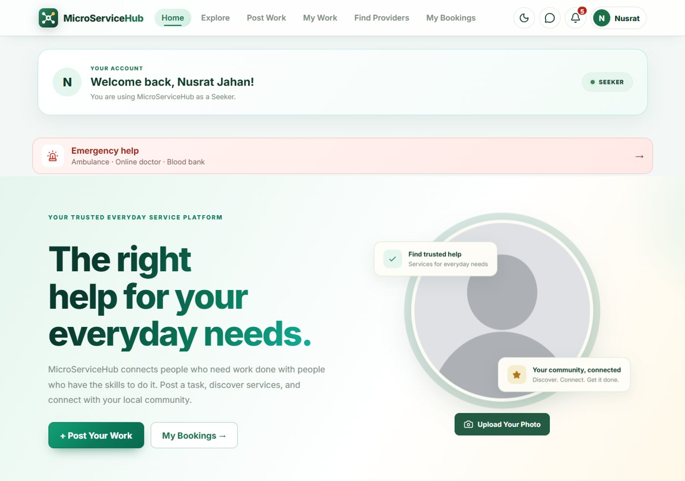

</div>

> Course project: CSE 3206, Software Engineering Laboratory.
> The demo runs on free hosting, so the first load can take up to a minute.

## Contents

- [Overview](#overview)
- [Features](#features)
- [Screenshots](#screenshots)
- [Tech stack](#tech-stack)
- [Architecture](#architecture)
- [API overview](#api-overview)
- [Project structure](#project-structure)
- [Getting started](#getting-started)
- [Configuration](#configuration)
- [Testing](#testing)
- [Deployment](#deployment)
- [Known limitations](#known-limitations)

## Overview

People who need a job done (**seekers**) find people who do it (**providers**), agree on a price, pay safely, and can reach emergency help (ambulance, doctor, blood bank) from the same app.

| Role | What they do |
| --- | --- |
| **Seeker** | Posts work or books a service, compares offers, hires, pays, reviews, asks for emergency help |
| **Provider** | Applies to work with an optional own price, publishes services, gets paid, builds a reputation |
| **Admin** | Verifies identity, moderates, decides disputes, runs ambulances, doctors and the blood bank |
| **Main admin** | Everything an admin does, plus admins, categories, fees and promo codes |

## Features

**Hiring**
- Post a work request; providers apply with a message and an optional price; the seeker compares and hires one.
- Or browse provider services and book one for a date.
- Explore screen with every service type, search, filters, reviews, saved providers and portfolios.

**Trust and safety**
- Every user is verified with a NID (or birth certificate under 18) and a selfie, reviewed by an admin.
- Photos are visible only to their owner and admins.
- Reports, moderation, bans and an admin team with a protected main admin.

**Money**
- Cash and Nagad payments confirmed by the provider.
- Escrow, disputes, platform fee, promo and referral codes are built into the backend and ready for an online payment gateway.

**Communication and location**
- Chat, voice calls (WebRTC) and notifications: in-app, phone push, email and SMS.
- Opt-in "Available now" map and consent-based live location sharing.

**Emergency help (managed by the admin team)**
- **Ambulance:** choose a free one and follow it live on a map. The driver shares the position from a secret link, no login needed.
- **Doctor:** press "Checkup"; an admin approves it and sends a meeting link.
- **Blood bank:** join as a donor or ask for blood. Phone numbers are shared only with consent.

**Admin panel**
- Statistics, users, KYC review, moderation, payments, disputes, fees, categories, team, CSV service report and the emergency services.

## Screenshots

| | |
| --- | --- |
| 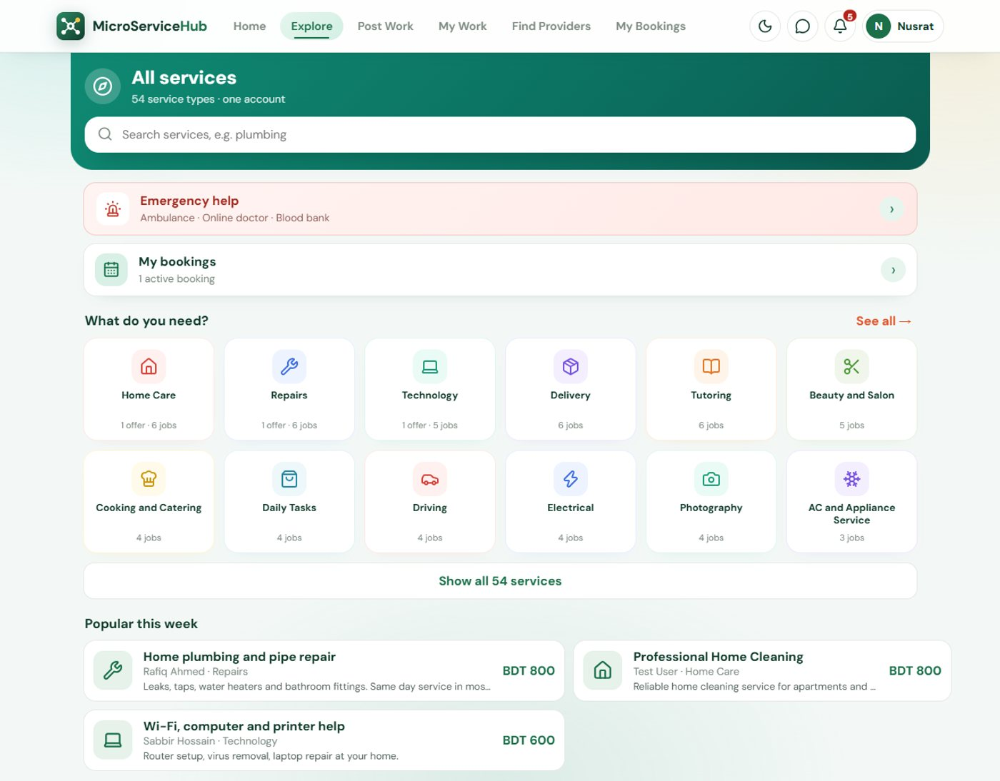 | 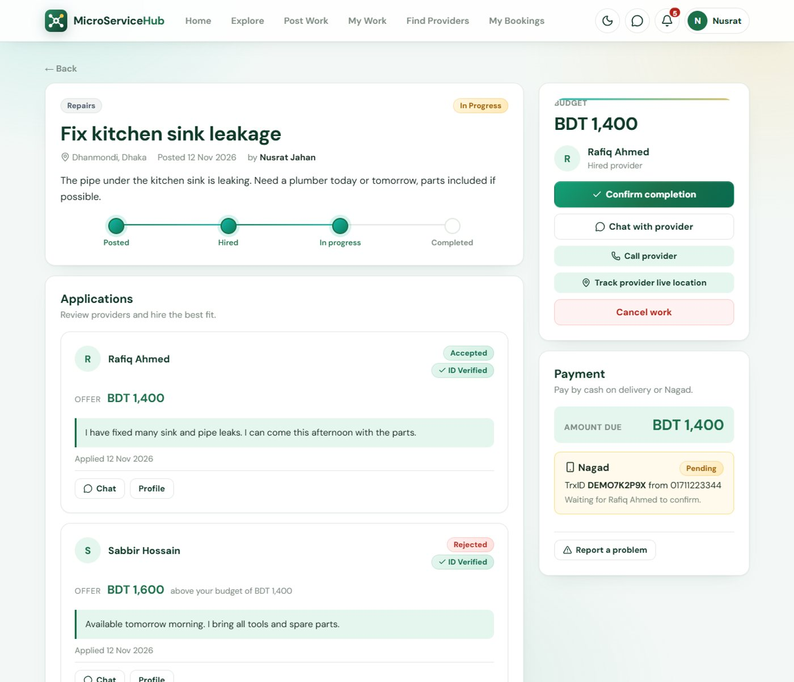 |
| **Explore** every service type | **Work details** with applications, progress and payment |
| 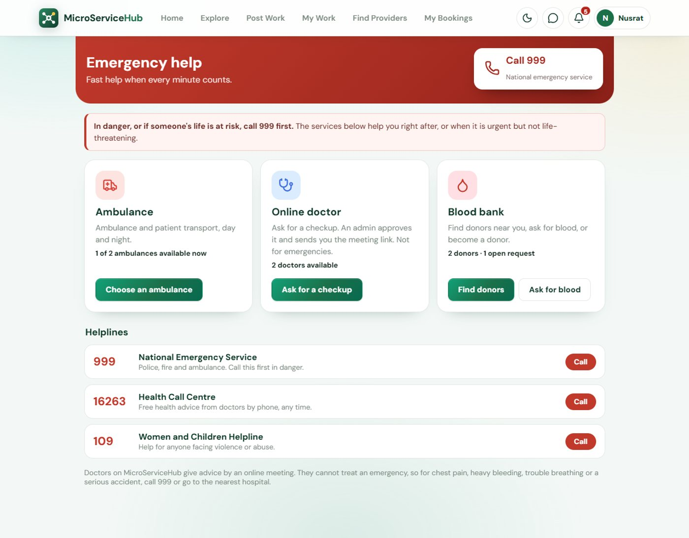 | 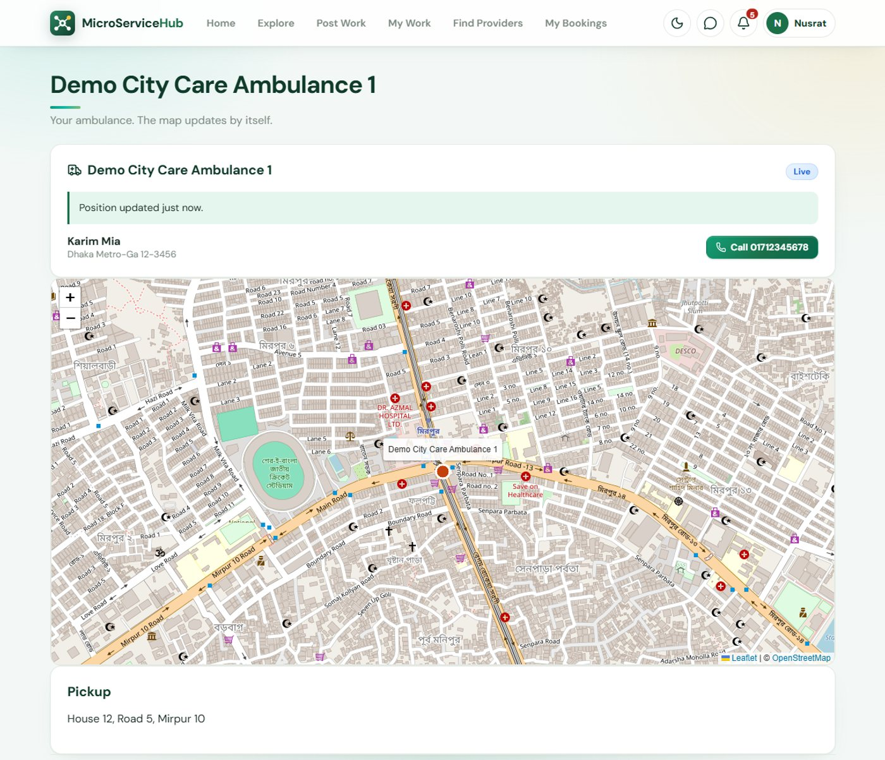 |
| **Emergency help** | **Following an ambulance** live |
| 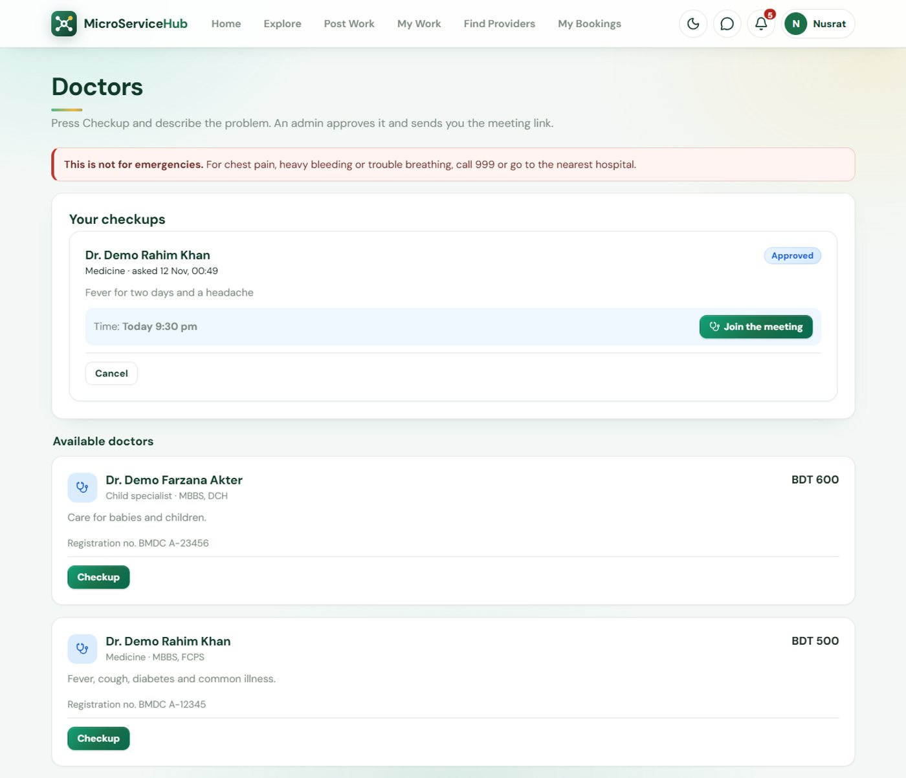 | 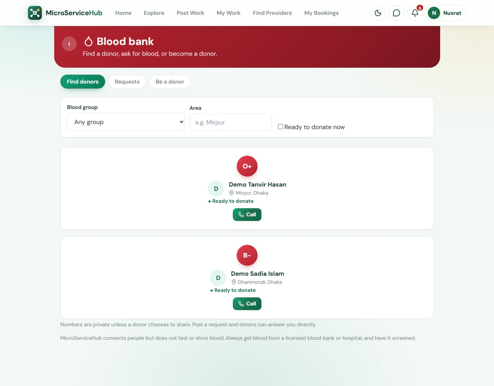 |
| **Doctor checkups** with the approved meeting link | **Blood bank** |
| 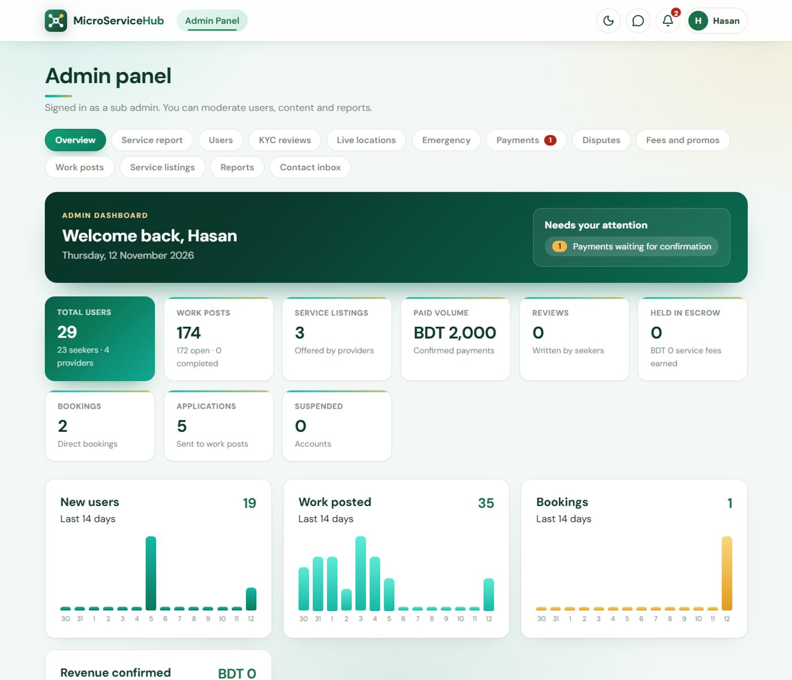 | 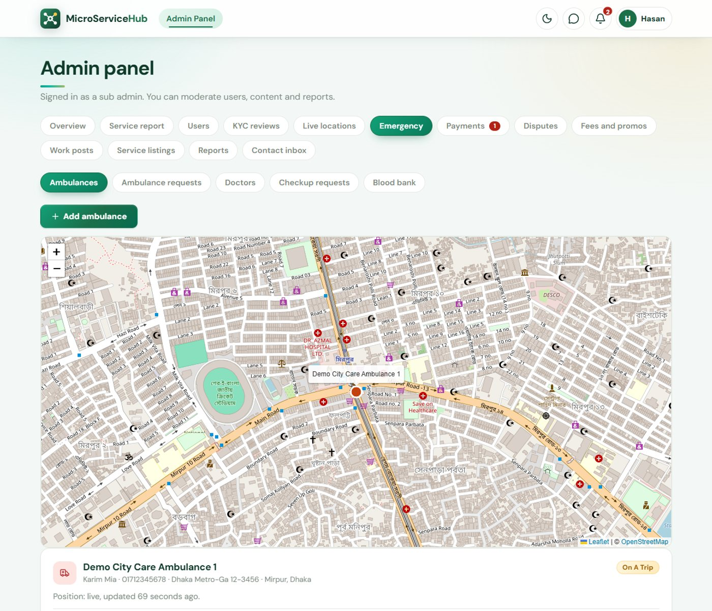 |
| **Admin panel** overview | **Admin** emergency tab |

Built phone-first:

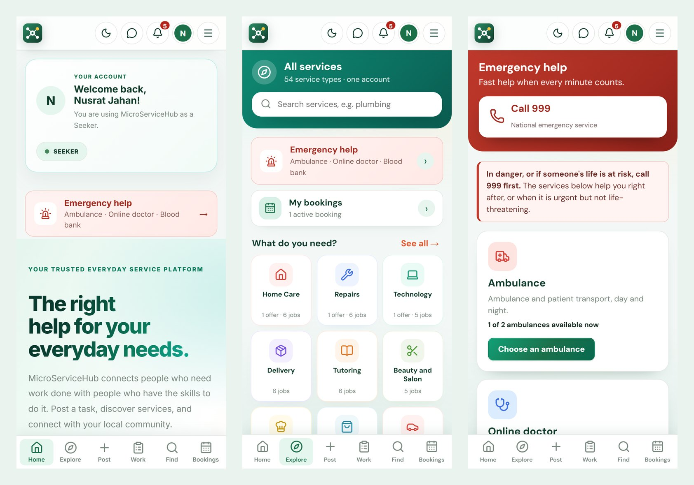

## Tech stack

| Part | Tools |
| --- | --- |
| Frontend | React 19, Vite, React Router, Leaflet, Socket.IO client, plain CSS |
| Backend | Node.js, Express 5, Socket.IO, JWT, bcryptjs, helmet, express-rate-limit, multer, web-push, nodemailer |
| Database | MySQL (TiDB Cloud in production, MariaDB/XAMPP locally) |
| Hosting | Render (app) and TiDB Cloud (database), deployed from GitHub |

## Architecture

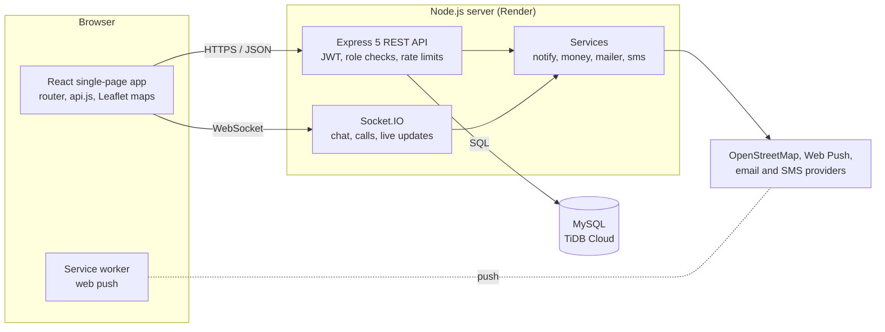

The Express server also serves the built React app, so the whole project deploys as a single web service.

## API overview

All routes start with `/api`. Protected routes need a JWT and are checked by role on the server.

| Module | Covers |
| --- | --- |
| `account`, `recovery` | Register, login (email and Google), email verification, password reset |
| `kyc` | Identity documents and admin review |
| `work` | Post work, apply, hire, start, complete |
| `listings` | Provider services, bookings, days off |
| `payments`, `marketplace` | Cash and Nagad payments, fee, promo codes, escrow, disputes |
| `social`, `extras`, `portfolio` | Reviews, favourites, earnings, contact form, portfolio |
| `location`, `presence` | Live location sharing and the "Available now" map |
| `emergency`, `blood` | Ambulances, doctors, checkups, blood donors and requests |
| `explore` | Data for the Explore screen |
| `admin` | Statistics, users, moderation, fees, admin team, reports |
| `push`, `images` | Web push subscriptions and stored images |

## Project structure

```
.
├── src/                 React app (pages, components, styles)
├── public/              manifest, service worker, icons, images
├── backend/
│   ├── server.js        Express app and Socket.IO
│   ├── migrate.js       creates and updates the database tables at start
│   ├── routes/          API modules
│   ├── tests/           automated tests
│   └── scripts/         create-admin, backup, restore
├── docs/screenshots/    images used in this README
├── render.yaml          Render deployment blueprint
└── DEPLOY.md            step by step deployment guide
```

## Getting started

You need Node.js 18 or newer and a MySQL or MariaDB server (for example XAMPP).

1. Create an empty database called `micro_service_hub`. The tables are created automatically when the backend starts.
2. Start the backend:
   ```bash
   cd backend
   cp .env.example .env      # then edit the database settings if needed
   npm install
   npm start                 # http://localhost:5000
   ```
3. Start the frontend (in another terminal, from the project root):
   ```bash
   npm install
   npm run dev               # http://localhost:5173
   ```
4. Create an admin account:
   ```bash
   cd backend
   npm run create-admin -- you@example.com "a-strong-password" "Your Name"
   ```

## Configuration

Settings live in `backend/.env` (see `backend/.env.example`).

| Variable | Purpose |
| --- | --- |
| `DB_HOST`, `DB_USER`, `DB_PASSWORD`, `DB_NAME`, `DB_PORT` | Database connection (defaults match XAMPP) |
| `JWT_SECRET` | Signs login tokens (generated on first start if empty) |
| `GOOGLE_CLIENT_ID` | Enables "Continue with Google" |
| `CORS_ORIGINS` | Extra allowed frontend origins |
| `DB_SSL` | Set to `true` for TiDB Cloud and other hosted databases |
| `APP_URL`, `API_PUBLIC_URL` | Public addresses, used in emails and links |
| `INITIAL_ADMIN_EMAIL`, `INITIAL_ADMIN_PASSWORD` | Creates the first admin on an empty database (remove after the first start) |

The frontend reads `VITE_API_URL` (default `http://localhost:5000`).

An online payment gateway, email and SMS need accounts at those providers. Without them the app still works: users pay the provider directly and the provider confirms.

## Testing

```bash
cd backend
npm test
```

The tests start the real server on a random port against a separate database (`micro_service_hub_test`) and call the real HTTP API.

## Deployment

The project deploys as one Render web service (the Express server also serves the built React app). See [`DEPLOY.md`](DEPLOY.md) and [`render.yaml`](render.yaml).

## Known limitations

- No online payment gateway is connected yet, so escrow, fees and promo codes have no payments to act on.
- Payouts are recorded as due and paid by an admin.
- The interface is in English only.
- The free hosting sleeps when idle.
